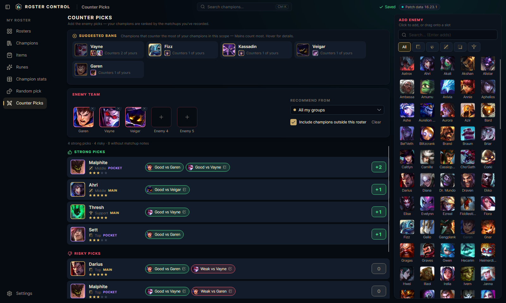

# Roster Control

A native Windows app for managing your League of Legends champion pool: drag champions into roster groups, rate how
good you are on each one, save rune pages, item sets, summoner spells and skill orders, record matchups, and get
counter-pick suggestions from your own notes.

**Uses only public, keyless data** (Riot's Data Dragon, Community Dragon and Meraki Analytics). It does **not** read
or control the League client, so there's nothing to log into and nothing that touches the game.

## Download

1. Get **RosterControl-win-Portable.zip** from the [latest release](https://github.com/tylersbreton/roster-control/releases/latest).
2. Unzip it anywhere you like (e.g. `Documents\Roster Control`) and run **Roster Control.exe**.

Windows 10/11 x64, no install or admin rights needed. Windows SmartScreen may warn about an unsigned app the first
time: *More info → Run anyway*. The first start downloads game data and images (internet needed once).

**Updates are automatic.** Roster Control checks GitHub for a new release at startup and every 4 hours, downloads it in
the background and shows **Restart to update** in the title bar when it's ready (also under *Settings → App updates*).
It never restarts on its own, and your data is untouched by updates.


| Rune page | Item set |
|---|---|
|  |  |

| Spells & skill order | Counter picks & suggested bans |
|---|---|
|  |  |

| Matchups per role | Item build path |
|---|---|
|  |  |

## Features

- **Rosters** — groups shown as columns (one per role by default: Top, Jungle, Middle, Bottom, Support). Drag champions
  from the pool into a group; drag cards to reorder or to move them to another group (hold **Ctrl** to copy); drag a
  card back onto the pool to remove it. Or right-click: *Add to …* on a pool champion, *Move to / Copy to* on a card.
  Add, rename, recolour, re-role, sort, reorder and delete groups. A **Compact** toggle fits more cards per column.
- **Proficiency & priority per placement** — 1–5 stars and Main / Secondary / Pocket / Learning, separately for each
  group (great Pantheon support, weak Pantheon top). Hover a card and press **1–5** to rate it (0 clears); click the
  priority label to change it.
- **Builds** — any number per champion (e.g. *Standard*, *vs AP*), each with:
  - a **rune page** laid out like the client: path icons, keystones, grayscale unselected runes, coloured selection rings,
    the client's rune-tree artwork, stat shards and full descriptions on hover. Selection rules match the client
    (two secondary runes from different rows; a third replaces the oldest).
  - an **item set** like the client's editor: named blocks, drag items in from a shop grouped by tier (Starter, Boots,
    Basic, Epic, Legendary…), stat filters, Summoner's Rift / ARAM toggle, search with nicknames (`ie`, `bork`, `dcap`),
    gold totals and full item tooltips with the **build path** (recipe tree with component costs, combine cost) and
    what each item **builds into**. Items removed in a later patch are flagged in red.
  - **summoner spells** (D/F slots) and an 18-level **skill order** grid with the champion's ability icons, rank limits,
    a "max order" summary and one-click fill (R at 6/11/16).
  - notes and a role tag.
  - **copy to another champion** (runes, items, spells and notes; the skill order is champion-specific).
- **Matchups** — *Good against* / *Weak against* lists per champion with a note per matchup (drag champions in, flip,
  reorder). A matchup applies to **all roles or one role** (Pantheon vs Darius can differ top vs support); a
  role-specific matchup overrides the all-roles one for that role. Matchups recorded on the other champion are shown
  too ("noted from the other side").
- **Counter Picks** — pick up to five enemies; each roster placement (all groups or one) is ranked by the matchups that
  apply to its group's role, including inverse ones, with proficiency and priority as tie-breakers.
- **Suggested bans** — the champions that counter the most of your champions in scope (Mains weigh most; champions you
  have answers to rank lower), with the reasons and notes on hover.
- **Champions library** — every champion with roster/build/matchup badges; filter by role, class, your tags.
- **Notes & tags** per champion.
- **Full screen** — F11 or the ⤢ caption button; leave with **Esc**, **F11** or *Exit full screen* in the title bar
  (or hover the top edge for the window's own controls).
- **Backup** — export/import all data as JSON; an automatic backup is written daily (last 10 kept).
- **Quick search** — **Ctrl+K** (or the search box in the title bar) finds champions (with the groups they're in),
  pages and actions; recently opened champions come first.
- **Undo** — deleting a build, group, item block, placement or matchup shows an *Undo* toast (also **Ctrl+Z**).
- **Step through a list** — a champion opened from a group, the pool or the library shows *‹ 2 / 5 ›* in its header;
  **Ctrl+←/→** moves to the previous / next champion.
- **Remembers where you were** — filters, searches, the last champion tab, editor tab, matchup role, shop filters and
  window zoom are kept between sessions. **Enter** in a search box opens or adds the first result.
- **Zoom** — 80–150 % (**Ctrl+=**, **Ctrl+-**, **Ctrl+0** or *Settings → Display*).

### Keyboard shortcuts

| Keys | Action |
|---|---|
| Ctrl+K / Ctrl+P | Quick search |
| Ctrl+1 … Ctrl+4 | Rosters · Champions · Counter Picks · Settings |
| Alt+← | Back |
| Ctrl+Z | Undo the last removal |
| Ctrl+= / Ctrl+- / Ctrl+0 | Zoom in / out / reset |
| F11, Esc | Full screen, leave full screen |
| Ctrl+N | New group (Rosters) or new build (champion page) |
| 1–5, 0, Delete | Rate, clear or remove the hovered roster card |
| Ctrl+Tab | Next tab on a champion page |
| Ctrl+← / Ctrl+→ | Previous / next champion in the list it was opened from |

## Data storage

Everything is local to each copy of the app, in the `data` folder **of the folder you unzipped** (next to
`Roster Control.exe`). Updates replace only the app files in `current\`, never `data\`:

| Path | Content |
|---|---|
| `data\roster.db` | SQLite database (groups, placements, builds, matchups, notes, preferences) |
| `data\backups\` | Automatic daily backups and safety backups taken before an import |
| `data\cache\` | Downloaded game data and images (safe to delete; re-downloaded). *Settings* shows its size and can clear the images. |
| `data\logs\` | Daily rolling logs (10 days) |

If the application folder isn't writable (e.g. under Program Files), `%LOCALAPPDATA%\RosterControl` is used instead.
`RosterControl.exe --data <folder>` stores data elsewhere. Copy the `data` folder (with the app closed) to move your
rosters, or use **Settings → Export**.

### Caching and patches

Everything that can be cached is, but champions are occasionally added and items change most patches, so:

| Data | Policy |
|---|---|
| Patch list (`versions.json`) | The app opens instantly from the newest cached patch, then checks online in the background (8 s timeout) and every 2 hours while running (every 10 minutes after an offline start). The first run downloads everything. A new patch shows an **Update** button in the title bar — it's never applied mid-edit. |
| Champions, items, runes, spells (per patch) | Immutable per patch → cached forever; a new patch is a new download. The newest 3 patches are kept, older ones pruned. |
| Portraits, item and spell icons | URLs include the patch → cached per patch, pruned with it. |
| Splash art, rune/shard/role icons (unversioned) | Re-validated after 7 days with ETag / If-Modified-Since (304 = keep); the cached copy is shown meanwhile. |
| Stat shards (Community Dragon) | Re-downloaded whenever the patch changes, otherwise daily. |
| Champion positions (Meraki) | Weekly, or sooner when a champion is missing (a new release; retried every 12 h until Meraki has it). |

New champions get a **NEW** badge. Builds saved on an older patch say so in the build list, and the item editor marks
items whose cost, stats or recipe changed since (and items removed from the game). Editing a build saves it on the
current patch, which marks it as reviewed.

## Development

Prerequisites: .NET SDK 10.0.100+, Windows. (Python 3 only to regenerate icons.)

```powershell
dotnet build RosterControl.sln
dotnet run --project src/RosterControl.Desktop                 # data goes to src\RosterControl.Desktop\bin\...\data
dotnet test tests/RosterControl.Tests                          # rules, parsers, repository, backup (offline)
dotnet test tests/RosterControl.UITests                        # headless UI + screenshots (needs internet on first run)
dotnet tool restore; dotnet ef migrations add <Name> --project src/RosterControl.Data --startup-project src/RosterControl.Data
python tools/generate_lucide_icons.py                          # regenerate Styles/Icons.axaml
dotnet run --project tools/RosterControl.DevTools -- icon src/RosterControl.Desktop/Assets
```

```text
src/
  RosterControl.Core/          models, game-data models, rules (rune pages, skill order, item shop, counter picks)
  RosterControl.Integrations/  Data Dragon / Community Dragon / Meraki client, disk cache, image cache, parser
  RosterControl.Data/          EF Core + SQLite (migrations), repository, preferences, backups
  RosterControl.Desktop/       Avalonia app (exe "RosterControl"): views, view models, drag & drop, styles
tests/  RosterControl.Tests · RosterControl.UITests (Avalonia headless)
tools/  publish.ps1 · generate_lucide_icons.py · RosterControl.DevTools (icon)
```

## Releasing

Releases are built by GitHub Actions ([release.yml](.github/workflows/release.yml)) when a version tag is pushed:

```powershell
git tag v1.0.1
git push origin v1.0.1
```

The workflow runs the unit tests, publishes a self-contained win-x64 build, packs it with
[Velopack](https://velopack.io) (portable zip + full and delta update packages) and creates the GitHub release with
generated notes. Running copies pick it up automatically. Every push and pull request also builds and runs the unit
tests ([ci.yml](.github/workflows/ci.yml)).

`.\tools\publish.ps1 -Version 1.0.0` still produces a plain (non-updating) portable build locally in `artifacts\publish`.

## Support

Roster Control is free and always will be. If it's useful to you, you can support development through
[GitHub Sponsors](https://github.com/sponsors/tylersbreton) (or the ❤ **Sponsor** button at the top of the repository).

## Legal

Roster Control isn't endorsed by Riot Games and doesn't reflect the views or opinions of Riot Games or anyone
officially involved in producing or managing Riot Games properties. Riot Games, and all associated properties are
trademarks or registered trademarks of Riot Games, Inc.

Roster Control is [MIT licensed](LICENSE). Third-party components: Avalonia (MIT), SkiaSharp (MIT),
CommunityToolkit.Mvvm (MIT), Velopack (MIT), EF Core / Microsoft.Extensions (MIT), Serilog (Apache-2.0),
Lucide icons (ISC), Inter (OFL 1.1).
